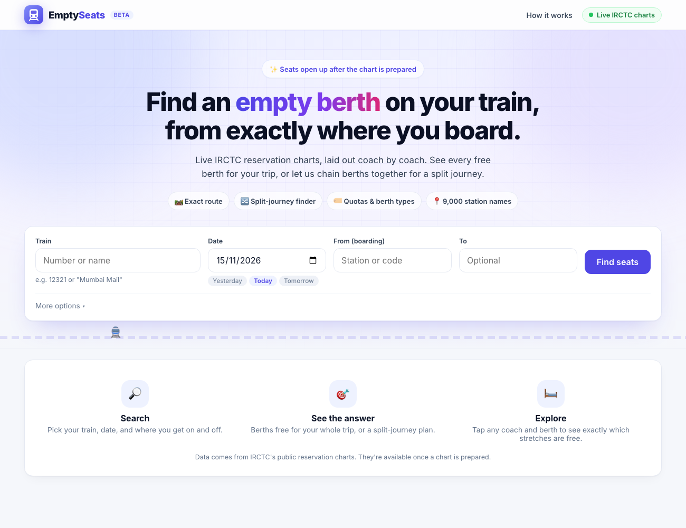
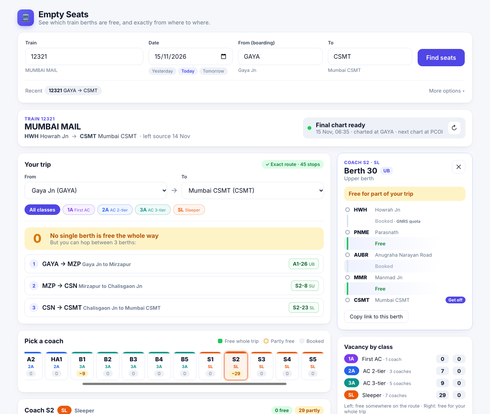
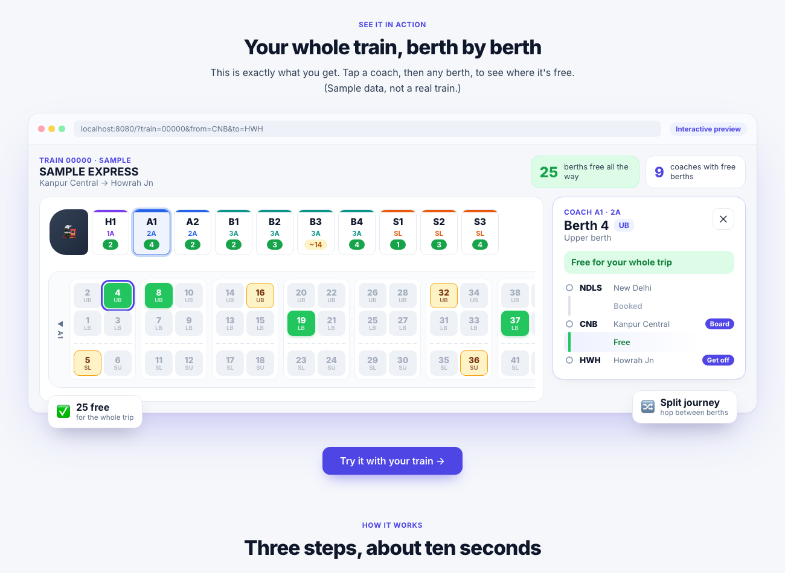

<div align="center">

# 🚆 EmptySeats

**Find an empty berth on an Indian Railways train, from exactly where you board.**

EmptySeats reads IRCTC's public reservation charts and lays the train out coach by coach and berth by berth.
Tap any berth to see which stretches of the route it's free on.


### 🌐 [**Try it live →**](https://emptyseats.vercel.app) &nbsp;·&nbsp; [Features](#features) &nbsp;·&nbsp; [How it works](#how-it-works) &nbsp;·&nbsp; [Run locally](#run-locally)




</div>

---

## Live demo

👉 **https://emptyseats.vercel.app** 

Try a train whose chart is already out (see [chart timings](#limits--honest-caveats)), for example any
long-distance train leaving in the next few hours.

## Why

After IRCTC prepares a train's chart, unbooked berths are released, but the official chart page makes them hard
to use. It lists vacancies coach by coach as raw station-code ranges, with no route, no layout and no way to ask
"what's free from **my** station to **my** station?"

EmptySeats answers that question directly:



## Features

| | |
|---|---|
| 🎯 **Trip answer** | Enter *From → To* and see how many berths are free for the whole trip, grouped by coach |
| 🔀 **Split-journey finder** | No single berth free all the way? It chains berths together with the fewest changes |
| 🛤️ **Exact route** | Station order comes from the vacancy and coach charts, with the timetable breaking ties, so "free from A to B" is accurate to the station |
| 🚃 **Train & seat map** | Engine plus every coach, with real bay layouts (SL / 3A / 3E 8-berth bays, 2A, 1A cabins, chair-car rows) |
| 🛏️ **Berth timeline** | Every stretch a berth is free or booked, with quota (General, Tatkal, Ladies…) and board / get-off markers |
| 🚉 **Train-aware stations** | Pick a train and *From / To* offer only its stops, in order (▾ to browse); *To* lists only stops after *From* |
| 🔎 **Fuzzy station search** | ~9,000 stations by name, code, old name or with typos: `bombay`, `nasik raod`, `pt deen` |
| 📊 **Insights** | Vacancy per class, and the stations where seats open up |
| 🔗 **Deep links** | `?train=12321&date=2026-11-15&from=GAYA&to=NK&coach=B1&berth=59` |
| 📥 **Offline / HAR import** | Load a DevTools HAR export and browse it without calling IRCTC |
| 📱 **Mobile-first** | Berth details open as a bottom sheet; works well on a station platform |

<details>
<summary><b>Interactive preview on the homepage</b></summary>
<br/>
First-time visitors get a live, clickable demo running on sample data:
<br/><br/>

</details>

## How it works

```
                 ┌──────────────────────────── browser ─────────────────────────────┐
                 │ React UI: search · trip answer · train strip · seat map · panel  │
                 └───────────────┬──────────────────────────────────────────────────┘
                                 │ /api/*
                 ┌───────────────▼───────────────┐
                 │  Rust (axum) API              │  in-memory cache (2 min TTL)
                 │  /api/chart   /api/coaches    │  stale-on-error fallback
                 │  /api/coach   /api/trains     │  HAR import
                 └───────────────┬───────────────┘
                                 │ HTTPS
           https://www.irctc.co.in/online-charts/api/…
```

| IRCTC endpoint | Used for |
|---|---|
| `trainComposition` `{trainNo, jDate, boardingStation}` | Coaches, charting station, chart times |
| `vacantBerth` `{…, cls, chartType}` | Vacant segments per berth, one call per class, in parallel |
| `coachComposition` `{…, coach, cls}` | One coach's berth chains + quotas. Fetched only for the coach you open (plus 4 busy coaches when the train isn't in the timetable), so a search costs ~5 requests, not ~30 |

The berth logic lives in [`frontend/src/logic.ts`](frontend/src/logic.ts):

- **Stations** are ordered by a topological sort over every berth's segment chain.
- **Each berth's vacancies** become merged intervals of station indices.
- **"Free for my trip"** means one interval covers `[from, to)`.
- **The split-journey finder** walks from your boarding station, each time picking the berth that reaches furthest.

## Run locally

**Requirements:** Rust (stable) and Node 20+.

```bash
git clone https://github.com/Aryan-xo/EmptySeats.git
cd EmptySeats
./dev.sh                     # builds the UI, then serves everything on http://localhost:8080
```

To work on the frontend with hot reload:

```bash
cd backend  && cargo run                    # API on :8080
cd frontend && npm install && npm run dev   # UI on :5173, proxies /api → :8080
```

To try it without hitting IRCTC, open **More options → Import HAR file…** and pick
[`fixtures/sample-22359.har`](fixtures/sample-22359.har).

### Configuration (backend env vars)

| Variable | Default | Purpose |
|---|---|---|
| `PORT` | `8080` | Port to listen on |
| `HOST` | `127.0.0.1` | Bind address (`0.0.0.0` in containers) |
| `CACHE_TTL_SECS` | `120` | How long IRCTC responses are reused |
| `IRCTC_USER_AGENT` | Chrome UA | IRCTC's CDN resets requests from non-browser user agents |
| `STATIC_DIR` | `../frontend/dist` | Built UI to serve (local mode) |

## Deploy to Vercel

The repo is set up as a single Vercel project with **two services** ([`vercel.json`](vercel.json)):

- `frontend`: the Vite build, served from Vercel's CDN
- `backend`: the Rust API, built from [`backend/Dockerfile.vercel`](backend/Dockerfile.vercel) and run as a container; `/api/*` is routed to it

Import the repo at [vercel.com/new](https://vercel.com/new) (leave the root directory as the repo root), or run `vercel`
from the repo root. See **Limits** below before relying on it in production.

## Limits & honest caveats

- **Charts only exist after IRCTC prepares them:** 
  - **First chart:** the night before (around 8 PM, 9 PM in some zones) for trains leaving between 5 AM and 2 PM;
    about 10 hours before departure for all other trains.
  - **Final chart:** 30 minutes before departure.
- **Stations where no berth changes hands don't appear on the route.** If your stop is missing, pick the next one
  after it.
- **IRCTC blocks cloud IPs (403).** So the hosted site fetches charts from the **visitor's browser**: IRCTC's chart API
  allows cross-origin requests. The Rust backend is the automatic fallback, and is used locally and for HAR import.
- **IRCTC also rate-limits busy networks.** Too many requests and it refuses a connection for a few minutes. The app
  keeps requests low (coach charts only on demand, cached answers) and, after repeated refusals, pauses for 1–8 minutes
  instead of retrying into the block.
- **The cache is per instance** (in memory), and HAR import is meant for local use. On serverless hosts, requests
  over 4.5 MB are rejected.
- **Stops before a search** come from the exact route of an earlier search in your browser, or else from
  `frontend/public/routes.json` (halts from the datameet/railways schedules, with renamed codes updated). That
  timetable covers about 5,000 trains and can be out of date, so the station lists always offer *Search all
  stations*.
- Station names come from the open [datameet/railways](https://github.com/datameet/railways) dataset, plus manual
  fixes for renamed codes (CSMT, DDU, PCOI…). Unknown codes show as just the code.

## Project layout

```
backend/            Rust API (axum + reqwest)
  src/main.rs       endpoints, IRCTC client, cache, HAR import
  data/             bundled train list
  Dockerfile.vercel container image for Vercel
frontend/           React + TypeScript (Vite)
  src/logic.ts      route ordering, vacancy intervals, split-journey finder
  src/fuzzy.ts      typo-tolerant station search
  src/layout.ts     coach layouts and berth codes
  src/components/   UI (search, trip panel, train strip, coach map, berth panel, landing)
  src/data/         station code → name map
fixtures/           sample HAR for offline testing
vercel.json         Vercel services config
```

## Disclaimer

EmptySeats is an independent project. It is **not affiliated with IRCTC or Indian Railways**. It only reads
publicly available reservation charts and does not book tickets. Please use it responsibly: the backend caches
responses so it doesn't hammer IRCTC.
